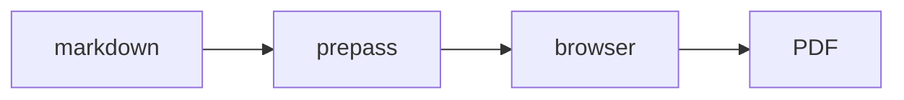

# ドキュメントに図を入れる方法(PDF を超えたエクスポート)

このガイドでは、`/make-pdf` と `/diagram` に付属する図とマルチフォーマットのエンジンを扱います(v1.58.0.0 以降)。ここで説明することはすべてオフラインで動作します。mermaid と excalidraw のランタイムは `lib/diagram-render/` にベンダリングされ、`bin/gstack-render.ts` がブラウザに読み込みます。このスクリプトは、1回のレンダリングの間だけ、バンドルをループバック上でマシンから配信します。CDN もレンダリング時のネットワークも使いません。ブラウザは、Aside が開いているとき(macOS 15 以降)は Aside のブラウザです。開いていない場合(Linux、Windows、または Aside を閉じている場合)は、同じバンドルが gstack 独自のバンドル済みブラウザでレンダリングされるので、どのプラットフォームでもオフラインで描画できます(PNG は、フォールバック時は 1x、Aside 経由では 2x で出力されます)。

## PDF の中に mermaid の図を描画する

Markdown にフェンスを置くだけです。それで完了です。

````markdown

````

```bash
make-pdf generate doc.md out.pdf
```

このフェンスは**ベクター**の図として描画されます(どの倍率でもくっきりしていて、テキストは選択可能です)。`title` は図のキャプションとアクセシビリティのラベルになります。mermaid の生のソースは、デバッグや往復変換のために、図の `data-gstack-source` 属性に base64 エンコードされて保持されます(HTML コメントにすると、mermaid の `-->` の矢印が壊れてしまうため、そうしていません)。注意点が1つあります。フェンスは**列 0**から始まる必要があります。インデントされたフェンス(たとえばリストの中)は、設計どおり通常のコードブロックのままになります。

**フェンスのオプション**(情報文字列の中でスペース区切り):

| オプション | 効果 |
|---|---|
| `title="..."` | 図の下のキャプション + `aria-label` |
| `render=false` | フェンスを通常のコードブロックのまま残す |
| `page=landscape` | この図を、横向きの専用ページに強制的に配置する |
| `page=portrait` | この図について、横向きの自動配置を拒否する |

解析に失敗したフェンスは、解析エラーとソースの抜粋を含む、目立つ赤い診断ブロックとして描画されます。ドキュメント全体はビルドされ続け、エラーは見逃しようがありません。

` ```excalidraw ` のフェンスも同じように動作します。本文は完全な `.excalidraw` のシーンファイルです(excalidraw.com で File → Save したものと同じ)。

## 画像のサイズと向きを制御する

ローカルの画像は自動的にインライン化されます(相対パスは Markdown ファイルを基準に解決されます)。また、画像が**切り詰められることは決してありません**。どの画像もコンテンツボックスの幅で上限が決まります。大きすぎる写真は、印刷解像度(コンテンツ幅で 300dpi)にダウンスケールされるので、スマートフォンの写真でドキュメントが肥大化することはありません。

画像の安全性のデフォルト: リモート(http/https)の画像は、`--allow-network` を渡さない限り、目に見えるプレースホルダーに**置き換えられてブロック**されます。Markdown のディレクトリの外に解決される画像パス(シンボリックリンク経由でも)は、インライン化はされますが、大きな警告が出ます。64MB を超えるファイルや、通常のファイルでないもの(FIFO、デバイス)は、描画をハングさせる代わりに、プレースホルダーに置き換えられます。

画像ごとのディレクティブは、画像の直後に置きます。

```markdown
{width=full}
{width=2in}
{page=landscape}
{page=portrait}
```

`width=` には、`full`、パーセンテージ(`50%`)、寸法(`3in`、`8cm`、`200px`)を指定できます。`page=` は、横向きの専用ページを強制または拒否します。

**横向きの自動配置:** 横長で、文字が小さく、図らしい画像には、自動的に縦方向の中央に配置された横向きの専用ページが与えられます。縦向きのドキュメントの中でも行われます。ヒューリスティックは意図的に保守的です(アスペクト比 ≥ 1.8、固有の幅がコンテンツボックスの約 2.5 倍を超える、そして図らしい alt の語: diagram / architecture / flowchart / chart / graph のいずれか)。思った通りに発動しない場合は `{page=landscape}` を追加し、発動してほしくない場合は `{page=portrait}` を追加してください。

## 単一ファイルの HTML または Word にエクスポートする

```bash
make-pdf generate doc.md out.html --to html
make-pdf generate doc.md out.docx --to docx
```

- **`--to html`** は、1つの自己完結したファイルを書き出します。図はインラインの SVG、画像はデータ URI になり、ネットワークへの参照はゼロです(デフォルトのオフラインの方針の下では。`--allow-network` を指定すると、リモートの画像タグは意図的に有効のままになります)。さらに、画面で読むための層(中央揃えの行長、パディング)も含みます。メールに添付したり、どこでも開けたりします。
- **`--to docx`** は、内容の忠実度を重視したエクスポートです。見出し、表、コードブロック、リスト、図(300dpi の PNG として、代替テキスト付きで埋め込まれる)が引き継がれます。ページ単位の完璧なレイアウトは保証されません。開いた後のレイアウトは Word の仕事です。

注意: `--to` は出力形式です。`--format` は `--page-size` の古い別名で、別の意味です。

## 英語の説明から図を生成する

```
/diagram make a flowchart of our deploy pipeline: build, test, canary, promote
```

スキルは mermaid を書き、**3点セット**を出力します。

| ファイル | 用途 |
|---|---|
| `<slug>.mmd` | 正となるソース。編集して再描画する |
| `<slug>.excalidraw` | excalidraw.com で開く(File → Open)。箱を動かして、また渡す |
| `<slug>.svg` / `<slug>.png` | ドキュメント、issue、README、チャット用 |

フローチャートは、完全に編集可能な excalidraw のシーンに変換されます。ほかの mermaid の種類(シーケンス、状態、ガント)は SVG/PNG にきちんと描画されますが、`.excalidraw` の成果物は省かれます。これは上流のコンバータの制限で、スキルがその旨を伝えます。

ドキュメントでは、PNG ではなく `.mmd` のソースを Markdown に埋め込んでください。`/make-pdf` がそれをベクターとして描画するので、図はずっと編集可能なままです。

## CI: プレースホルダーを出荷する代わりに大きく失敗させる

```bash
make-pdf generate docs.md --strict
```

ローカルの画像の欠落、ブロックされたリモート画像、Markdown のディレクトリの外へ出る画像の読み取り(パスやシンボリックリンクが外に解決される場合)、大きすぎるファイル(>64MB)、通常のファイルでないものは、いずれも警告やプレースホルダーに落とす代わりに、ゼロ以外の終了コードで終了します。壊れた画像がビルドを壊すべきドキュメントのパイプライン向けです。

## トラブルシューティング

- **「diagram-render bundle not found」** → gstack のリポジトリで `bun run build:diagram-render` を実行するか、`./setup` を再実行してください。
- **図は描画されるが、インラインで潰れて見える** → 横長なので、フェンスに `page=landscape` を指定して余裕を持たせてください。
- **1本の長い線ではなく、2行の「racetrack」のループになる** → mermaid のサブグラフの小技: トップレベルは `flowchart TB`、2つのサブグラフに `direction LR` と `direction RL` を設定し、*サブグラフ同士*を接続します(サブグラフの境界をまたぐノード同士の辺は、`direction` を黙って無効にします)。
- **「[remote image blocked]」のプレースホルダー** → リモートの画像は、デフォルトでは決して取得されません(オフラインの方針)。タグは目に見えるプレースホルダーに置き換えられるので、印刷時にもブラウザが取得できません。使いたい場合は `--allow-network` を指定してください。
